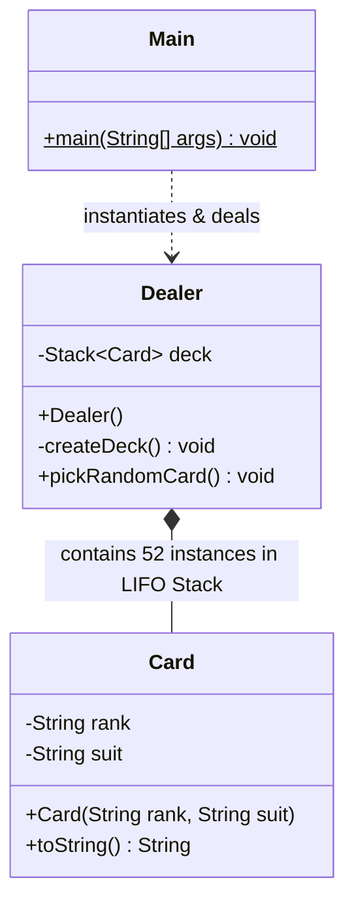

<div align="center">


[](https://www.java.com/)
[](#)
[](#)
[](LICENSE)
[](#)

</div>

---

## 📌 Executive Summary / Overview

The **Card Game Deck Simulator** (`cardgame-repo`) is a modular Object-Oriented Java simulation modeling a standard 52-card French deck, cryptographic pseudo-random card shuffling, and deal mechanics. Developed to demonstrate advanced object-oriented programming (OOP) principles, the project emphasizes domain modeling, state encapsulation, and data structure selection.

Card gaming engines require deterministic state control and equitable randomness. This project implements a decoupled design separating the atomic entity (`Card`) from the stateful dealer agent (`Dealer`), utilizing a Last-In-First-Out (LIFO) `java.util.Stack<Card>` collection for constant-time $O(1)$ pop operations when drawing cards.

---

## 📖 Interactive Table of Contents

- [Executive Summary / Overview](#-executive-summary--overview)
- [Key Features & Capabilities](#-key-features--capabilities)
- [System Architecture & UML Domain Model](#-system-architecture--uml-domain-model)
- [Tech Stack Breakdown](#-tech-stack-breakdown)
- [Card Domain Specification](#-card-domain-specification)
- [Reproducible Quickstart & Setup](#-reproducible-quickstart--setup)
- [Project Directory Layout](#-project-directory-layout)
- [Author & Contributions](#-author--contributions)

---

## ✨ Key Features & Capabilities

- **LIFO Stack Deal Mechanics**: Stores the shuffled card deck inside `java.util.Stack<Card>`, ensuring rigorous $O(1)$ constant time card draws and pops.
- **Robust 52-Card Factory Generation**: Programmatically instantiates standard combinations of 4 suits (Hearts, Diamonds, Clubs, Spades) across 13 rank denominations (2–10, Jack, Queen, King, Ace).
- **Uniform Pseudo-Random Shuffling**: Employs `Collections.shuffle()` to guarantee an unbiased permutation of cards before loading into the active dealer stack.
- **Strict OOP Encapsulation**: Private state fields protected behind constructor injection and formatted string representations (`toString()`).
- **Comprehensive UML Domain Diagram**: Repository includes `Object based diagram.jpg` detailing class relationships, associations, and method signatures.

---

## 🏗️ System Architecture & UML Domain Model



---

## 🛠️ Tech Stack Breakdown

| Category | Technologies & Tools |
| :--- | :--- |
| **Language** | Java (JDK 11, 17, or 21) |
| **Architecture** | Object-Oriented Programming (OOP), Domain-Driven Modeling |
| **Data Structures** | `java.util.Stack<Card>`, `java.util.ArrayList<Card>` |
| **Algorithms** | Permutation Shuffling (`Collections.shuffle`) |
| **Diagrams & Specs** | Object-Based UML Structural Diagrams |

---

## 🃏 Card Domain Specification

| Component | Values / Range | Total Count |
| :--- | :--- | :--- |
| **Suits** | Hearts ($\color{red}{\heartsuit}$), Diamonds ($\color{red}{\diamondsuit}$), Clubs ($\clubsuit$), Spades ($\spadesuit$) | 4 |
| **Ranks** | `2`, `3`, `4`, `5`, `6`, `7`, `8`, `9`, `10`, `Jack`, `Queen`, `King`, `Ace` | 13 |
| **Full Deck Size**| $4 \times 13 = 52$ unique card instances | 52 |
| **Draw Complexity**| $O(1)$ via Stack `pop()` | Immediate |

---

## 🚀 Reproducible Quickstart & Setup

### Prerequisites
- Java Development Kit (JDK 11+) installed and verified (`javac -version`)

### Step 1: Clone the Repository
```bash
git clone https://github.com/Jeshwanthika07/cardgame-repo.git
cd cardgame-repo
```

### Step 2: Compile the Source Code
```bash
javac Card.java Dealer.java Main.java
```

### Step 3: Run the Dealer Simulation
```bash
java Main
```
Sample console output:
```text
Picked card: Ace of Spades
Picked card: 7 of Hearts
Picked card: King of Diamonds
Picked card: 3 of Clubs
Picked card: Queen of Hearts
```

---

## 📂 Project Directory Layout

```text
cardgame-repo/
│
├── Card.java                  # Encapsulated atomic card entity (rank & suit)
├── Dealer.java                # Stateful dealer agent with deck stack operations
├── Main.java                  # Application execution driver & sample deal loop
├── Object based diagram.jpg   # Architectural UML object and class diagram
├── .gitattributes             # Git repository attribute configuration
└── README.md                  # Comprehensive technical documentation
```

---

## 👩‍💻 Author & Contributions

Authored by **[Jeshwanthika Pothamchetty](https://github.com/Jeshwanthika07)**  
*Alliance University | Department of Computer Applications*

<div align="center">


</div>
